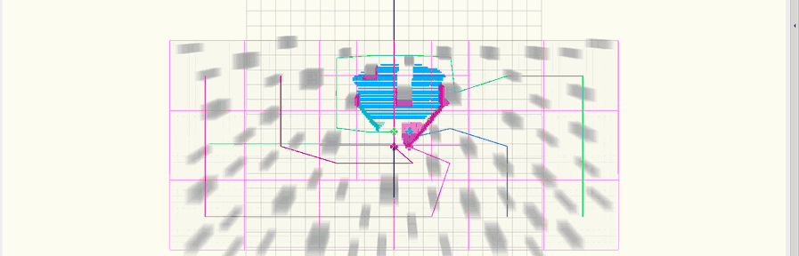

# RACER ROS 2 Pillar Demo

This repository contains a ROS 2 Humble port of the RACER multi-drone
exploration demo. The main runnable scenario is the pillar-map demo with four
simulated drones, local point-cloud sensing, RACER exploration/planning, and
RViz2 visualization.

This port is based on the original
[Robotics-STAR-Lab/RACER](https://github.com/Robotics-STAR-Lab/RACER) codebase,
which implements rapid collaborative exploration with a decentralized multi-UAV
system.



## 10-Run Demo Benchmark

Latest headless pillar-demo benchmark, generated on 2026-05-26 with:

```bash
ROS_LOG_DIR=/tmp/racer_ros_logs tools/benchmark_pillar.sh --runs 10 \
  --timeout-sec 180 --output benchmark_results/pillar_runs_10.csv \
  --log-dir benchmark_results/logs_10
```

| Runs completed | Completion modes | Avg exploration time | Avg total path length | Avg wall time | Avg coverage |
| ---: | --- | ---: | ---: | ---: | ---: |
| 10/10 | 9 `no_grid`, 1 `stable_metrics` | 45.520 s | 147.016 m | 50.782 s | 94.345% |

| Metric | Mean | Median | Min | Max | Stddev |
| --- | ---: | ---: | ---: | ---: | ---: |
| Exploration time (s) | 45.520 | 43.112 | 38.735 | 62.537 | 6.875 |
| Total path length (m) | 147.016 | 145.374 | 128.024 | 169.468 | 11.281 |
| Coverage (%) | 94.345 | 94.401 | 93.564 | 95.001 | 0.511 |

All commands below are meant to be run from the repository root. The commands
use relative paths only.

## Requirements

Use a terminal where ROS 2 Humble is already available.

Check the shell first:

```bash
ros2 --help
colcon --help
```

Install common build tools if needed:

```bash
sudo apt update
sudo apt install python3-colcon-common-extensions python3-rosdep
```

Install package dependencies:

```bash
rosdep update
rosdep install --from-paths src --ignore-src -r -y
```

You also need a desktop session or X server for RViz2.

## Build

Build only the ROS 2 packages under `src`:

```bash
colcon build --symlink-install --base-paths src
source install/setup.bash
```

Use a smaller rebuild while editing the demo:

```bash
colcon build --symlink-install --base-paths src \
  --packages-select plan_env exploration_manager
source install/setup.bash
```

## Run The Demo

Start the pillar demo with RViz2:

```bash
source install/setup.bash
ros2 launch exploration_manager racer_pillar.launch.py
```

Run without RViz2:

```bash
source install/setup.bash
ros2 launch exploration_manager racer_pillar.launch.py rviz:=false
```

If RViz2 has rendering problems, force software rendering:

```bash
source install/setup.bash
LIBGL_ALWAYS_SOFTWARE=1 ros2 launch exploration_manager racer_pillar.launch.py \
  rviz_gl_vendor:=mesa
```

## Start Exploration

The launch waits for a goal on `move_base_simple/goal`.

In RViz2:

1. Wait for the map and display tree to load.
2. Select `2D Goal Pose`.
3. Click near the center of the map and drag to set the heading.

From another terminal:

```bash
source install/setup.bash
timeout 10 ros2 topic pub -r 10 move_base_simple/goal \
  geometry_msgs/msg/PoseStamped \
  "{header: {frame_id: world}, pose: {position: {x: 0.0, y: 0.0, z: 1.0}, orientation: {w: 1.0}}}"
```

The repeated publish gives all four exploration nodes time to receive the same
start goal.

## Expected Output

The demo starts:

- `map_generator` for the pillar map.
- Four `exploration_node` processes.
- Four `traj_server` processes.
- Four `poscmd_2_odom` lightweight simulator processes.
- Four `pcl_render_node` local sensing processes.
- Four odometry visualization nodes.

When exploration finishes, each exploration node prints `No grid`. The
trajectory servers also print one summary line per drone:

```text
Drone <id>, [<time>,<length>,<velocity>,<energy>], [time, length, vel, energy]
```

A typical pillar run finishes in about `40-60 s`, but timing and path length
vary because planning and map updates are not deterministic.

## Benchmark

Run repeated clean headless trials and write CSV/log output under
`benchmark_results`:

```bash
source install/setup.bash
python3 tools/benchmark_pillar.py --runs 5 --timeout-sec 120 \
  --output benchmark_results/pillar_runs.csv \
  --log-dir benchmark_results/logs
```

For a longer run:

```bash
source install/setup.bash
python3 tools/benchmark_pillar.py --runs 10 --timeout-sec 180 \
  --output benchmark_results/pillar_runs_10.csv \
  --log-dir benchmark_results/logs_10
```

The CSV includes exploration time, total path length, wall time, completion
mode, and per-drone coverage percentages.

## Useful Launch Arguments

```bash
rviz:=true
rviz:=false
rviz_gl_vendor:=mesa
coverage_metrics:=true
coverage_report_interval_sec:=1.0
show_grid_text:=true
```

HGrid debug text labels are hidden by default. Set `show_grid_text:=true`
when you want the numbered grid IDs in RViz2.

Example with coverage logs enabled:

```bash
source install/setup.bash
ros2 launch exploration_manager racer_pillar.launch.py \
  coverage_metrics:=true coverage_report_interval_sec:=1.0
```

## Troubleshooting

If `ros2` cannot find `exploration_manager`, source the workspace again:

```bash
source install/setup.bash
```

If `colcon` reports duplicate package names, make sure the build command uses
`--base-paths src`.

If exploration does not start, publish the goal again:

```bash
source install/setup.bash
timeout 10 ros2 topic pub -r 10 move_base_simple/goal \
  geometry_msgs/msg/PoseStamped \
  "{header: {frame_id: world}, pose: {position: {x: 0.0, y: 0.0, z: 1.0}, orientation: {w: 1.0}}}"
```

If RViz2 opens but the scene is blank, check that demo topics are present:

```bash
source install/setup.bash
ros2 topic list | grep -E "map_generator|sdf_map|planning_vis|odom_visualization"
```

Stop a run with `Ctrl-C` in the launch terminal. Start a fresh terminal, source
`install/setup.bash`, and launch again for a clean interactive run.
